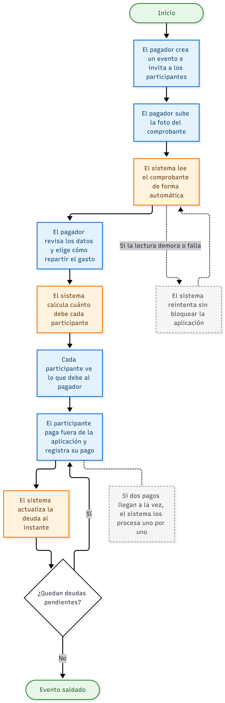
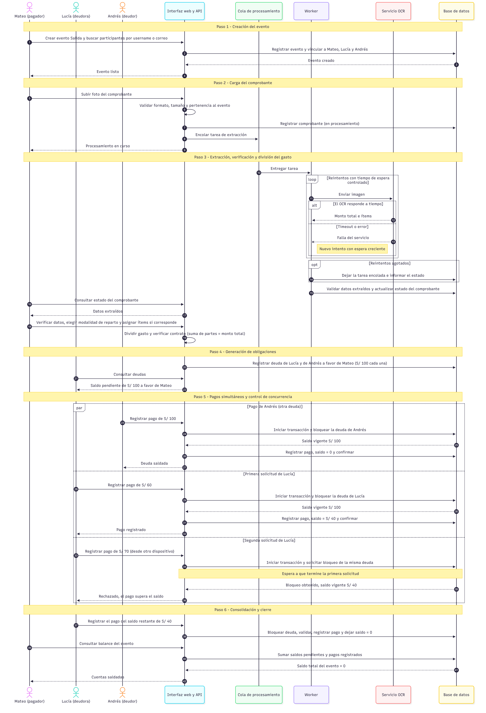
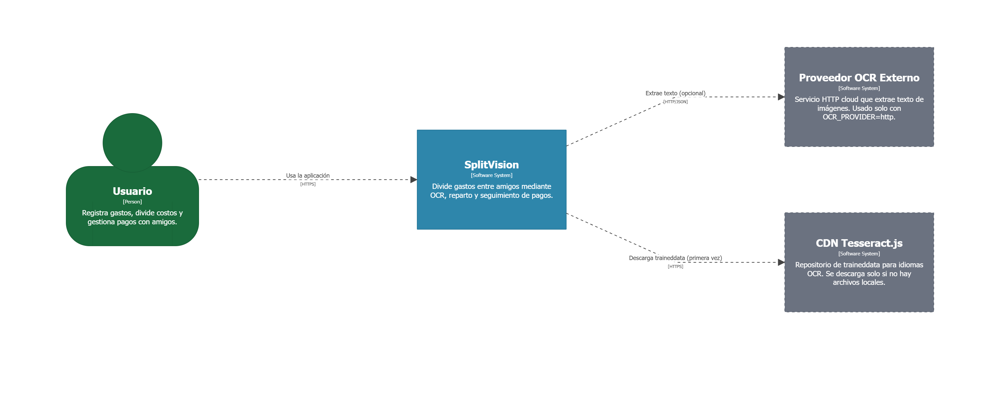
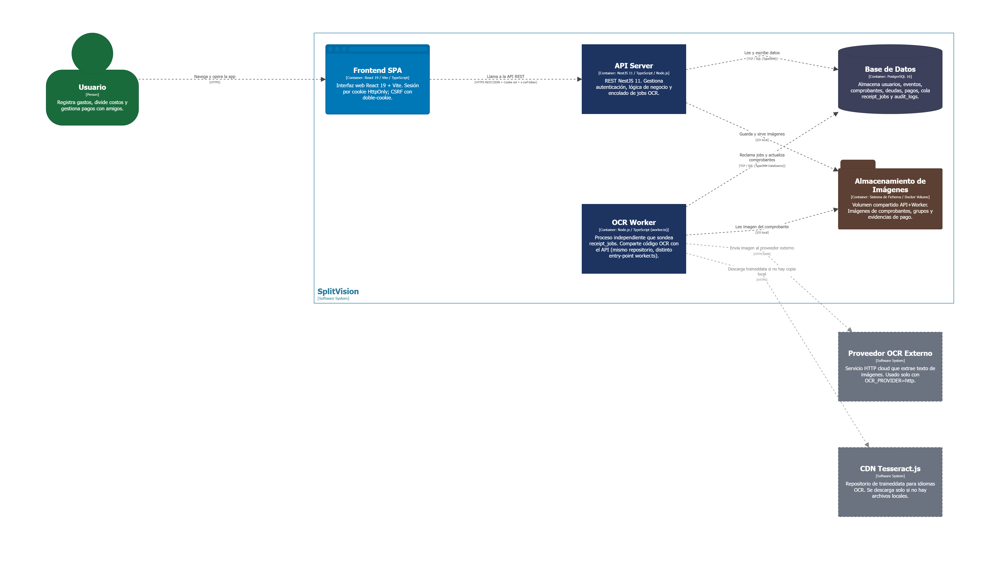
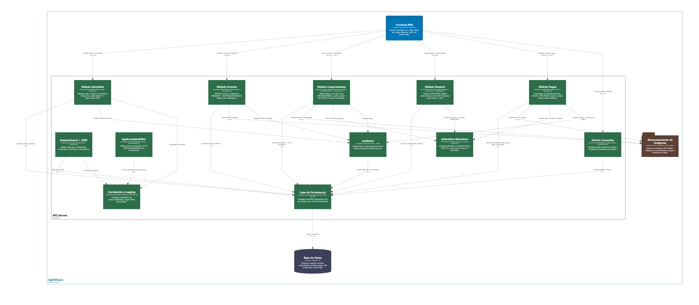
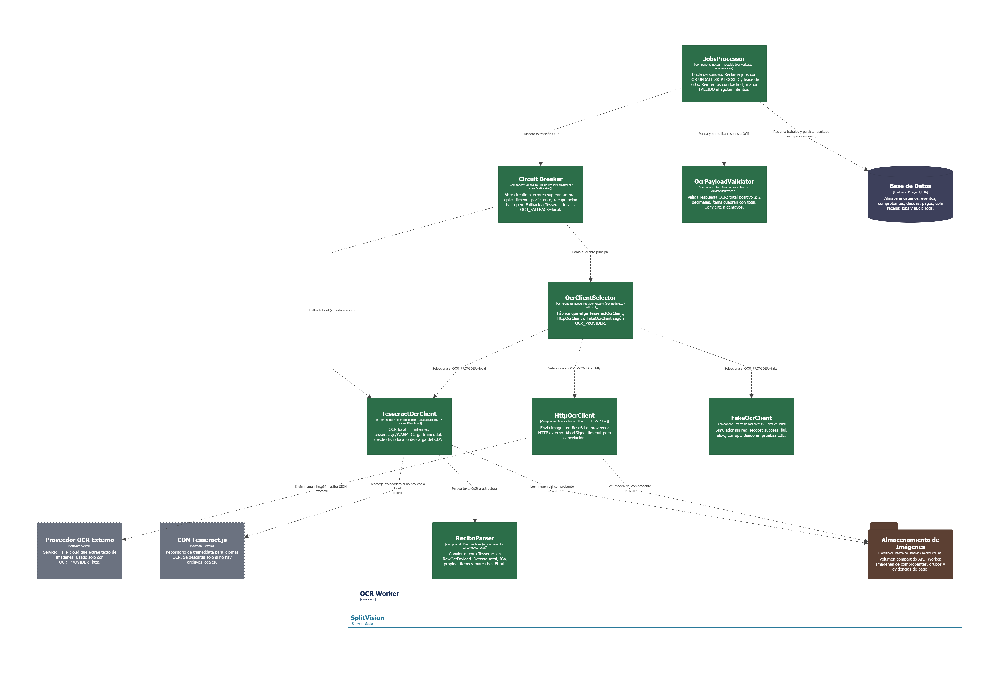
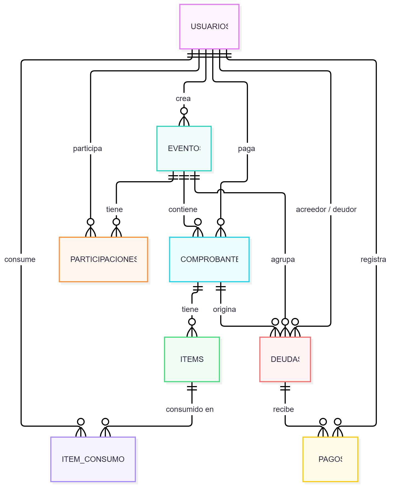

# Documento Técnico Parcial (v1.0) - SplitVision

**Curso:** Construcción de Software II (SW707)

**Equipo:**

- Gonzalo Albornoz
- Luis Angel Vargas Ponce — 20231314E
- Farid Zamudio

**Fecha:** 1 de octubre de 2026

## 1. Descripción del problema y usuarios

### 1.1. Contexto y problema del usuario

En grupos colaborativos, como compañeros de universidad, _roommates_ o grupos de viaje, la división de gastos compartidos suele realizarse de manera manual y es propensa a errores. Cuando varios integrantes asumen diferentes costos ,por ejemplo, uno paga las entradas a un evento, otro la comida y otro el transporte,determinar cuánto debe pagar cada persona y quién le debe a quién puede convertirse en un proceso confuso y generar fricción entre los integrantes del grupo.

Aunque los comprobantes físicos o digitales constituyen la fuente de verdad de las transacciones, la necesidad de transcribir manualmente la información de estos comprobantes para registrar los gastos resulta ineficiente y aumenta la posibilidad de errores.

### 1.2. Problema técnico de Construcción de Software

Para automatizar este proceso, el sistema enfrenta tres retos de construcción que van más allá de la implementación de un CRUD convencional: dos retos críticos, relacionados con el control de concurrencia en la liquidación de deudas y con el procesamiento asíncrono de extracción OCR con datos no confiables, y un reto adicional de corrección numérica y conservación de masa en el cálculo de montos de dinero.

#### A. Condiciones de carrera y concurrencia en el ciclo de vida de pagos

El sistema modela las obligaciones financieras mediante una matriz de deudas donde cada registro mantiene montos desagregados (`Monto_Total`, `Saldo_Confirmado` y `Saldo_Reservado`), de los cuales se deriva el saldo disponible para amortización:
$$\mathrm{Saldo\_Disponible} = \mathrm{Monto\_Total} - (\mathrm{Saldo\_Confirmado} + \mathrm{Saldo\_Reservado})$$

Este recurso crítico está expuesto a condiciones de carrera por dos escenarios cotidianos y altamente probables en la operación del sistema:

1. **Doble envío por latencia de red móvil (*Double Submit*):** Cuando un deudor registra un pago desde un dispositivo móvil bajo una conexión inestable (3G/Wi-Fi con pérdida de paquetes), la ausencia de respuesta inmediata suele provocar que el usuario presione repetidamente el botón de envío o que el cliente HTTP reintente la solicitud. Dos peticiones idénticas llegan al servidor con escasos milisegundos de diferencia.
2. **Conflicto concurrente entre Deudor y Acreedor:** Cuando un deudor registra un pago, este ingresa en estado `PENDIENTE` reservando saldo. Casi de inmediato, el deudor puede decidir cancelar su solicitud (`POST /payments/:id/cancel`) mientras que, al mismo tiempo, el acreedor interactúa con su Bandeja de Cobros para confirmar (`POST /payments/:id/confirm`) o rechazar (`POST /payments/:id/reject`) la evidencia enviada. Asimismo, un deudor puede intentar ingresar un segundo pago parcial mientras el acreedor está resolviendo el primero.

En ambos escenarios, si las operaciones no se ejecutan de manera atómica y serializada, se produce el defecto conocido como **Actualización Perdida (*Lost Update*)**, derivado de un antipatrón de verificar y luego actuar (*check-then-act*) sin aislamiento:
1. Dos hilos concurrentes leen el mismo estado y saldo vigente de la deuda.
2. Ambos verifican exitosamente las precondiciones con información que queda desactualizada en milisegundos.
3. Ambos escriben sus modificaciones en la base de datos de forma desfasada.

Como consecuencia, se vulneran las invariantes fundamentales del dominio: el saldo disponible puede volverse negativo, los montos reservados pueden desincronizarse de los pagos reales y el balance contable del evento queda corrompido. Para resolver este reto, el sistema implementa **bloqueos pesimistas a nivel de fila (`SELECT ... FOR UPDATE`)** dentro de transacciones de base de datos aisladas, garantizando una evaluación secuencial y atómica, complementada con **llaves de idempotencia (`Idempotency-Key`)** para descartar reenvíos duplicados.

#### B. Cómputo intensivo asíncrono y datos no confiables de extracción OCR

Para evitar la transcripción manual de comprobantes, el sistema incorpora un motor de **Reconocimiento Óptico de Caracteres (OCR)** encargado de extraer automáticamente los ítems, precios y montos totales a partir de imágenes de boletas y facturas.

En esta versión v1.0, el procesamiento OCR no se delega a una API cloud externa de pago, sino que se ejecuta de forma local mediante un motor especializado (**Tesseract.js / WebAssembly**). Esta decisión arquitectónica introduce retos de construcción sustanciales:

- **Bloqueo del Event Loop por cómputo intensivo (*CPU-Bound*):** El procesamiento de imágenes, binarización y ejecución de redes neuronales de OCR demanda un uso intensivo de CPU. Si se ejecutara dentro del hilo principal de la API de Node.js, bloquearía el *Event Loop*, degradando severamente la latencia e impidiendo que el servidor atienda solicitudes HTTP de otros usuarios. Por ello, la extracción se delega a un **proceso Worker independiente** mediante una cola de tareas asíncronas persistida en PostgreSQL.
- **Gestión del ciclo de vida y problemas de runtime (*Memory Leaks*):** Los workers nativos de Tesseract en WebAssembly/C++ administran buffers de memoria significativos. Si su ciclo de vida no se gestiona estrictamente liberando los recursos al terminar (`worker.terminate()`), se producen fugas de memoria progresivas que agotan el heap del proceso.
- **Naturaleza inherentemente no confiable del resultado OCR:** Los comprobantes físicos peruanos presentan comúnmente arrugas, manchas, iluminación deficiente o impresiones térmicas desgastadas. En consecuencia, el texto extraído es información ruidosa y no confiable: montos truncados, caracteres alfanuméricos confundidos (como 'O' por '0') o líneas incompletas. El sistema aplica **programación defensiva rigurosa** (expresiones regulares defensivas, validación de esquemas y parseo seguro) y establece un paso obligatorio de verificación y corrección humana antes de que cualquier dato del comprobante sea utilizado para generar deudas.
- **Desacoplamiento arquitectónico mediante el patrón Adapter:** Para garantizar la capacidad de evolución del sistema hacia proveedores OCR en la nube en el Examen Final, la lógica de extracción se aísla mediante una interfaz canónica `OcrProvider`. Actualmente se soportan `TesseractOcrProvider` y `MockOcrProvider`, desacoplando completamente la lógica de negocio del motor de reconocimiento.

#### C. Precisión aritmética en el cálculo de montos y conservación de masa

La división de gastos en grupos rara vez produce números enteros o divisiones exactas. Por ejemplo, al dividir una cuenta de S/ 100.00 de manera equitativa entre tres participantes, cada uno debería pagar S/ 33.3333... La suma aritmética de tres cuotas truncadas a dos decimales (S/ 33.33 × 3) produce S/ 99.99, generándose una pérdida contable de un centavo (S/ 0.01). 

Asimismo, los lenguajes de programación modernos representan los números fraccionarios bajo el estándar de punto flotante de doble precisión **IEEE 754**. En dicho estándar, ciertas fracciones decimales no tienen representación binaria finita exacta (por ejemplo, `0.1 + 0.2 === 0.30000000000000004`), lo cual acumula errores catastróficos en balances financieros.

Para garantizar la integridad matemática, SplitVision aplica:
1. **Representación entera exacta en centavos:** Ningún cálculo financiero utiliza punto flotante. Todos los montos se modelan y almacenan como enteros en céntimos (`amount_cents`), eliminando de raíz el error de precisión binaria.
2. **Invariante de conservación de masa (*Design by Contract*):** El motor de división implementa un contrato matemático estricto donde la suma de las partes asignadas debe ser idéntica al total del comprobante:
$$\sum_{i=1}^{n} \mathrm{parte}_i \equiv \mathrm{total\_comprobante}$$
3. **Algoritmo determinista de asignación de residuos:** Los centavos indivisibles no se descartan ni se crean de la nada; se asignan de manera predecible a los participantes siguiendo un orden determinista de desempate (*tie-break*). Esta invariante es verificada automáticamente mediante pruebas basadas en propiedades (*Property-Based Testing* con `fast-check`) sobre miles de combinaciones aleatorias.

#### D. Relación entre los retos y las técnicas del curso

La siguiente tabla resume cómo cada reto técnico se vincula directamente con las técnicas de construcción de software exigidas en SW707:

| Reto de construcción | Riesgo principal | Técnica aplicada | Sección en doc |
| :--- | :--- | :--- | :--- |
| **Concurrencia en la liquidación de deudas** | *Lost Update*, saldo negativo y pagos duplicados por *double-submit* o resolución simultánea acreedor/deudor | Bloqueo pesimista a nivel de fila (`SELECT ... FOR UPDATE`), aislamiento transaccional y llaves de idempotencia (`Idempotency-Key`) | 8 |
| **Cómputo intensivo de extracción OCR** | Bloqueo del *Event Loop* de la API y degradación de disponibilidad del sistema | Arquitectura desacoplada en dos procesos (API y Worker) y cola de tareas asíncronas en PostgreSQL | 3 y 5 |
| **Datos no confiables del OCR** | Generación de deudas con montos erróneos o corrupción de datos por lectura ruidosa | Programación defensiva, parseo resiliente, esquemas de validación y verificación humana obligatoria | 6.2 |
| **Precisión numérica y reparto de residuos** | Pérdida de centavos y balances descuadrados por redondeo o imprecisión IEEE 754 | Aritmética entera en centavos, contratos de software (*Design by Contract*) y *Property-Based Testing* | 5 y 6.1 |
| **Fugas de memoria en el runtime** | Agotamiento del heap de memoria por workers de WebAssembly/C++ no destruidos | Gestión explícita del ciclo de vida de recursos y terminación de workers nativos | 5 |

### 1.3. Usuarios / Actores del sistema

#### 1.3.1. Usuarios finales (grupos colaborativos)

Son las personas registradas en el sistema con una cuenta propia, que interactúan de forma concurrente para cargar comprobantes, verificar las extracciones automáticas y saldar deudas cruzadas. Dentro de un evento, un usuario puede desempeñar los siguientes roles:

- **Pagador (acreedor):** integrante que asumió el pago de un gasto y carga el comprobante correspondiente. Verifica los datos extraídos, selecciona la modalidad de reparto y recibe los pagos de los demás integrantes. El usuario que crea el evento y vincula a los participantes puede, o no, ser el pagador.
- **Participante (deudor):** integrante vinculado al evento que mantiene saldos pendientes a favor de otros integrantes, consulta sus deudas y registra los pagos correspondientes.
  Estos roles son contextuales y no dependen de la cuenta: un mismo usuario puede ser acreedor en un gasto y deudor en otro dentro del mismo evento, o tener roles distintos en eventos diferentes.

#### 1.3.2. Subsistema de Extracción (Motor OCR en Worker)

Componente del sistema desacoplado mediante un proceso Worker asíncrono, encargado del procesamiento de imágenes y reconocimiento óptico de comprobantes físicos a través de Tesseract.js / WebAssembly. Se comunica mediante una cola de tareas en PostgreSQL y utiliza el patrón Adapter para aislar la lógica del motor de reconocimiento, permitiendo evaluar el rendimiento ante tareas intensivas de CPU y memoria sin comprometer la API principal.

### 1.4. Objetivo del prototipo (v1.0)

**Objetivo general:** construir un prototipo funcional de SplitVision que permita registrar gastos compartidos a partir de comprobantes registrar la liquidación de las deudas entre los integrantes de un evento, garantizando la consistencia de los saldos ante operaciones concurrentes y la continuidad del servicio ante fallas del servicio OCR.

**Objetivos específicos:**

- Garantizar la integridad de la matriz de deudas ante pagos simultáneos mediante control de concurrencia y bloqueos transaccionales.
- Mantener la disponibilidad del sistema ante latencia, errores o indisponibilidad del servicio OCR mediante procesamiento en segundo plano y mecanismos de tolerancia a fallas.
- Asegurar que la suma de las deudas generadas sea equivalente al monto total del comprobante mediante contratos de diseño (_Design by Contract_).
- Proteger el sistema frente a datos de entrada no confiables, incluidos los resultados del servicio OCR, mediante programación defensiva.

## 2. Alcance y requisitos principales

### 2.1. Delimitación del Prototipo Funcional (Alcance v1.0)

El prototipo funcional que se presentará en el Examen Parcial implementa un flujo de negocio completo, desde la creación de un evento hasta la liquidación de las deudas entre sus integrantes. Los objetivos de esta versión se describen en la sección 1.4; esta sección delimita qué funcionalidades se incluyen y cuáles quedan fuera. La versión v1.0 constituye la línea base que será evolucionada posteriormente hasta la versión final del proyecto.

**Dentro del alcance (v1.0):**

- Autenticación básica nativa mediante cuentas propias de usuario (RF1).
- Creación de eventos y vinculación de participantes registrados (RF2).
- Carga de comprobantes y extracción de su información mediante un proceso Worker con OCR local (Tesseract.js), procesada en segundo plano (RF3).
- Verificación de los datos extraídos por parte del usuario y algoritmo de división de gastos, mediante reparto equitativo o reparto por ítems con conservación estricta de masa monetaria (RF4).
- Registro de pagos con comprobante/evidencia obligatoria, máquina de estados de pago (`PENDIENTE`, `CONFIRMADO`, `RECHAZADO`, `CANCELADO`) y Bandeja de verificación para el acreedor, respaldado por bloqueo pesimista a nivel de fila (`SELECT ... FOR UPDATE`) y llaves de idempotencia para garantizar la serialización de solicitudes concurrentes (RF5).
- Consulta de deudas, estado de cuenta por participante y balance general del evento (RF6).
- Interfaz web SPA desarrollada en React y TypeScript que permite ejecutar el flujo de negocio completo de forma intuitiva tanto en computadoras de escritorio como en dispositivos móviles.

**Fuera del alcance (v1.0):**

- Pasarelas bancarias automatizadas de débito directo en cuenta (Visa, Mastercard, Stripe). La transferencia de fondos se realiza mediante billeteras digitales peruanas (Yape, Plin) o banca móvil fuera del sistema, y los usuarios registran el pago subiendo su comprobante a SplitVision.
- Custodia, intermediación o retención legal de fondos monetarios.
- Inicio de sesión con proveedores de identidad externos / redes sociales (OAuth).
- Notificaciones push nativas al sistema operativo.
- Aplicación móvil nativa compilada para tiendas App Store o Google Play Store (la SPA Web está optimizada como aplicación web responsive accesible por red local).
- Despliegue final en infraestructura cloud de producción (se opera en entorno local contenerizado para la v1.0).

### 2.2. Modelo de Dominio y Operación (Sesiones)

Para responder a la necesidad de trazabilidad en las transacciones concurrentes, el dominio operará bajo la siguiente estructura:

#### A. Usuarios Persistentes:

Cada actor en el sistema requiere una cuenta propia (ID único, username, email y contraseña cifrada con Argon2) para iniciar sesión de forma independiente. El username y el correo electrónico deben ser únicos dentro del sistema, ya que permiten identificar y buscar usuarios para vincularlos a eventos. Las contraseñas nunca se almacenan en texto plano.

No existen "sesiones grupales" ni un único usuario que anota por todos. Esta identidad persistente permite vincular cada operación con el usuario que la realizó, lo que garantiza la trazabilidad y la no repudiación de las transacciones.

#### B. Eventos (Agrupadores Temporales):

Los usuarios interactúan dentro de "Eventos" (ej. "Viaje a Cusco", "Cena de Fin de Ciclo"). El Evento es la entidad padre donde se vinculan los participantes y que delimita el contexto de los gastos, las deudas y los permisos.

#### C. Comprobantes y Extracción:

El sistema extrae la información del comprobante mediante el Worker asíncrono y el usuario verifica los datos obtenidos. El gasto podrá dividirse mediante reparto equitativo entre los participantes o mediante reparto por ítems, asignando los ítems consumidos a cada participante.

#### D. Matriz de Deudas y Pagos con Reserva:

Es la estructura relacional donde se registran las obligaciones entre los participantes de un evento. Para soportar concurrencia y amortizaciones parciales de forma matemáticamente robusta, cada deuda desagrega su estado financiero en céntimos: monto total (`amount_cents`), monto confirmado (`confirmed_cents`) y monto reservado en pagos pendientes (`reserved_cents`). 

Cuando un deudor registra un pago, este no cancela la deuda de inmediato; se registra en estado `PENDIENTE`, adjuntando su evidencia gráfica, e incrementa temporalmente el saldo reservado (`reserved_cents`), protegiendo el saldo disponible. El acreedor recibe el pago en su **Bandeja de Pagos**, donde puede confirmar la acreditación (trasladando el monto a `confirmed_cents`) o rechazarlo (liberando la reserva).

#### E. Entidades principales e invariantes

La siguiente tabla resume las entidades del dominio implementadas en el sistema:

| Entidad | Descripción | Atributos principales |
| :--- | :--- | :--- |
| **Usuario** | Persona registrada en el sistema con credenciales y datos de cobro | `id`, `username`, `email`, `password_hash` (Argon2), `preferred_wallet`, `phone`, `bank_name`, `account_number`, `cci`, `qr_image_path` |
| **Evento** | Agrupador de participantes, gastos y deudas | `id`, `name`, `creator_id`, `created_at` |
| **Participante** | Vínculo de membresía entre un usuario y un evento | `event_id`, `user_id`, `joined_at` |
| **Comprobante** | Gasto registrado a partir de una boleta/factura | `id`, `event_id`, `payer_id`, `total_cents`, `image_path`, `status` (`SUBIENDO`, `PROCESANDO`, `LISTO`, `CONFIRMADO`, `ERROR`) |
| **Ítem** | Línea de detalle del comprobante con su asignación | `id`, `receipt_id`, `description`, `quantity`, `unit_price_cents` |
| **Deuda** | Obligación financiera entre un deudor y un acreedor | `id`, `event_id`, `receipt_id`, `creditor_id`, `debtor_id`, `amount_cents`, `confirmed_cents`, `reserved_cents` |
| **Pago** | Transacción de amortización con evidencia y ciclo de vida | `id`, `debt_id`, `payer_id`, `amount_cents`, `method`, `evidence_path`, `status` (`PENDIENTE`, `CONFIRMADO`, `RECHAZADO`, `CANCELADO`), `idempotency_key`, `created_at`, `resolved_at` |

Las reglas que el sistema garantiza estrictamente en todo momento (**invariantes del dominio**) son:

1. **Invariante de no sobregiro ni saldo negativo:** En cualquier instante, la suma del saldo confirmado y el saldo reservado nunca puede superar el monto total de la deuda:
$$0 \le \mathrm{confirmed\_cents} + \mathrm{reserved\_cents} \le \mathrm{amount\_cents}$$
2. **Invariante de saldo disponible:** El saldo disponible para nuevos pagos se calcula de forma unívoca y determinista:
$$\mathrm{available\_cents} = \mathrm{amount\_cents} - (\mathrm{confirmed\_cents} + \mathrm{reserved\_cents})$$
3. **Invariante de conservación de masa monetaria:** La suma de las deudas generadas más la cuota asumida por el propio pagador es idéntica al monto total del comprobante verificado:
$$\sum_{i=1}^{k} \mathrm{deuda}_i + \mathrm{cuota\_pagador} \equiv \mathrm{total\_comprobante}$$

### 2.3. Flujo de Negocio

El siguiente diagrama de secuencia detalla la interacción asíncrona y la resolución del escenario concurrente. Corresponde a los seis pasos descritos en la sección 2.4.

#### Diagrama de Flujo del negocio Simplificado

<div align="center">



</div>

#### Diagrama de Flujo del negocio Detallado



### 2.4. Explicación del Flujo principal y comportamiento del sistema

Para facilitar la comprensión del dominio de negocio, se describe el ciclo de vida completo de una transacción mediante el siguiente escenario: los usuarios Mateo, Lucía y Andrés comparten una salida. Mateo realiza el pago inicial de la cuenta y el sistema debe gestionar la recuperación de los saldos entre ellos.

#### Paso 1: Inicialización de Dominio (Creación del Evento)

- **Acción del usuario:** Mateo inicializa un nuevo Evento ("Salida"), queda vinculado a él como primer participante y busca a Lucía y Andrés, que ya están registrados, mediante su username o correo electrónico para vincularlos al Evento.
- **Comportamiento del sistema:** el sistema crea una nueva entidad lógica (Evento) en la capa de persistencia y establece las relaciones de pertenencia entre los usuarios autenticados y este contenedor. Esta agrupación actúa como un límite de contexto: las consultas de saldos y los permisos de escritura quedan aislados y protegidos únicamente para los miembros vinculados.

#### Paso 2: Recepción y Delegación Asíncrona (Carga del Comprobante)

- **Acción del usuario:** Mateo carga la fotografía del comprobante para no ingresar el gasto manualmente.
- **Comportamiento del sistema:** el backend recibe el archivo y ejecuta validaciones defensivas sobre el formato y el tamaño de la imagen, además de verificar que el usuario pertenezca al evento. Para evitar el bloqueo del hilo de ejecución web (*Event Loop*) durante el procesamiento intensivo del motor OCR local (Tesseract.js / WebAssembly), el sistema delega el trabajo a una cola en segundo plano atendida por el Worker. De inmediato retorna al cliente el estado "Procesamiento en curso", con lo cual mantiene su disponibilidad y capacidad de respuesta.

#### Paso 3: Extracción, Verificación y Diseño por Contratos

- **Acción del usuario:** al finalizar la lectura, el estado del comprobante se actualiza y Mateo puede consultar la información extraída. Mateo verifica los datos (y los corrige si es necesario) y selecciona una modalidad de división: reparto equitativo o reparto por ítems. En el reparto por ítems, además, asigna los ítems a los participantes que los consumieron.
- **Comportamiento del sistema:** el Worker (procesador en segundo plano) ejecuta la extracción OCR aplicando los mecanismos de tolerancia a fallas descritos en la sección 9 (Circuit Breaker con Opossum, límites de tiempo de espera y reintentos controlados), garantizando que fallas de memoria o parsing en WebAssembly no desestabilicen al sistema principal. Si los reintentos se agotan, la tarea se marca con error de forma idempotente y el estado del comprobante informa la situación al usuario. La información recuperada se trata como un dato no confiable y se valida antes de presentarla al usuario. Una vez que Mateo confirma los datos y la modalidad, el motor de cálculo divide el gasto. En el reparto equitativo, el monto total se distribuye entre todos los participantes; en el reparto por ítems, la parte de cada participante se calcula según los ítems que tiene asignados. En ambos casos se aplica la regla definida para asignar los residuos de redondeo y se verifica, mediante un contrato de diseño (_Design by Contract_), que la suma de las partes asignadas sea equivalente al monto total del comprobante antes de persistir los datos.

#### Paso 4: Generación de Obligaciones (Matriz de Deuda)

- **Acción del usuario:** Lucía y Andrés pueden consultar en el sistema que mantienen un saldo pendiente, correspondiente a su parte del gasto, a favor de Mateo. Por ejemplo, si el comprobante es de S/ 300 y se reparte de forma equitativa, cada uno debe S/ 100.
- **Comportamiento del sistema:** se registran las deudas correspondientes en la base de datos, indicando el deudor, el acreedor y el saldo pendiente. Solo se generan deudas para los participantes distintos del pagador: la parte de Mateo no genera ninguna deuda, ya que él mismo pagó el gasto. Estos registros se convierten en el recurso crítico del sistema, sujeto a posibles actualizaciones simultáneas.

#### Paso 5: Amortización, Evidencia y Control de Concurrencia (El núcleo transaccional)

- **Acción del usuario:** Andrés realiza su pago de S/ 100 fuera de la aplicación (mediante Yape) y lo registra en SplitVision adjuntando la captura de su comprobante. Por su parte, Lucía tiene una deuda de S/ 100 y decide enviar un pago parcial de S/ 60. Debido a una conexión móvil inestable (*lag* de red 4G/Wi-Fi), Lucía presiona repetidamente el botón de envío o su cliente HTTP reintenta la solicitud, disparando dos peticiones casi simultáneas (una de S/ 60 y otra de S/ 70 que intenta registrar enseguida).
- **Comportamiento del sistema:** Para resolver este escenario crítico sin corromper el saldo, el motor transaccional aplica dos barreras defensivas:
  1. **Serialización mediante bloqueo pesimista a nivel de fila (`SELECT ... FOR UPDATE`):** La base de datos no procesa las dos peticiones a la vez de forma desordenada; forma una cola estricta y procesa las peticiones **una por una**. La primera solicitud adquiere el bloqueo exclusivo sobre el registro de la deuda, mientras que la segunda espera a que la primera concluya. La primera solicitud evalúa que S/ 60 $\le$ S/ 100 disponible, registra el pago en estado `PENDIENTE`, incrementa el saldo reservado a S/ 60 (`reserved_cents = 6000`), reduce el saldo disponible a S/ 40 y libera el bloqueo haciendo *commit*. Al ejecutarse a continuación, la segunda solicitud adquiere el bloqueo y evalúa sus precondiciones contra el *nuevo saldo disponible* (S/ 40); al requerir S/ 70, incumple la precondición y es rechazada limpiamente con un error 409 (*Conflict*), impidiendo la sobreescritura (*Lost Update*) y evitando que el saldo se vuelva negativo.
  2. **Control de duplicados por Idempotencia (`Idempotency-Key`):** Si la segunda solicitud corresponde a un reintento del mismo pago de S/ 60 con la misma llave de idempotencia enviada por el frontend, el sistema detecta la colisión mediante una restricción única en base de datos y retorna el pago ya registrado sin duplicar la reserva de saldo.

#### Paso 6: Verificación en Bandeja de Cobros, Consolidación y Cierre

- **Acción del usuario:** Mateo entra a su **Bandeja de Pagos** (`/bandeja-pagos`). Observa el pago de Andrés por S/ 100 y el de Lucía por S/ 60 con sus respectivas capturas de pantalla bancarias adjuntas. Mateo inspecciona las evidencias y presiona **"Confirmar pago"** para ambos. Lucía, notificada de que su pago fue acreditado y que su saldo restante es de S/ 40, transfiere los S/ 40 finales y Mateo los confirma en su Bandeja.
- **Comportamiento del sistema:** Al confirmar cada pago, el sistema ejecuta una transacción que actualiza el estado del pago a `CONFIRMADO` y traslada el monto desde `reserved_cents` hacia `confirmed_cents`. El saldo total pendiente de la deuda se reduce a cero. Las consultas de agregación del balance confirman que todos los saldos quedaron liquidados cumpliendo la invariante contable: para cada deuda, `confirmed_cents === amount_cents` y `available_cents === 0`.

### 2.5. Requisitos Funcionales (v1.0)

Derivado del flujo de negocio core, el prototipo funcional a presentar en la primera etapa deberá cumplir con los siguientes requerimientos:

#### RF1: Gestión de identidad y trazabilidad

- **Descripción:** el sistema debe permitir el registro y la autenticación básica de los usuarios para actuar como actores independientes y persistentes. Durante el registro, el usuario debe establecer un username único y un correo electrónico único que permitan su identificación y búsqueda dentro del sistema.
- **Criterio de aceptación técnico:** toda transacción (creación de evento, carga de comprobante, pago de deuda) debe estar obligatoriamente vinculada al identificador único del usuario en sesión, garantizando la trazabilidad necesaria para las operaciones transaccionales. El sistema debe rechazar registros con username o correo duplicados y no debe almacenar contraseñas en texto plano.

#### RF2: Agrupación y límites de contexto (eventos)

- **Descripción:** un usuario debe poder inicializar un Evento lógico y vincular a otros usuarios registrados mediante la búsqueda por username o correo electrónico.
- **Criterio de aceptación técnico:** las consultas de saldos y las operaciones de escritura deben estar estrictamente aisladas al contexto del Evento. Toda operación realizada por un usuario que no pertenezca al evento debe ser rechazada, previniendo la fuga de datos o modificaciones no autorizadas.

#### RF3: Procesamiento asíncrono de extracción (resiliencia y rendimiento)

- **Descripción:** el sistema debe permitir la recepción de imágenes de comprobantes y delegar a un proceso Worker especializado (OCR local con Tesseract.js / WebAssembly) la extracción de su información relevante, incluyendo el monto total y los ítems cuando estén disponibles. Asimismo, debe informar al cliente sobre el estado del proceso.
- **Criterio de aceptación técnico (SW707):** el procesamiento debe ejecutarse obligatoriamente en segundo plano desacoplado de la API principal para no degradar el *Event Loop*. La tarea se gestiona mediante una cola persistida en PostgreSQL. Si el procesamiento experimenta demoras o errores de parsing, el sistema principal mantiene su disponibilidad y aplica reintentos controlados con idempotencia para no generar comprobantes duplicados.

#### RF4: Motor de fraccionamiento y generación de deuda (contratos)

- **Descripción:** a partir del monto total del comprobante, verificado por el usuario, el sistema calcula la parte que corresponde a cada participante según la modalidad de reparto seleccionada: reparto equitativo o reparto por ítems. En el reparto equitativo, el monto se divide entre los participantes; en el reparto por ítems, la parte de cada participante se determina según los ítems que tenga asignados. Las deudas se generan a favor del pagador para los participantes distintos de él.
- **Criterio de aceptación técnico (SW707):** el algoritmo de división debe implementar programación por contratos (_Design by Contract_). Se debe evaluar la invariante de que la suma de las partes asignadas a todos los participantes (incluido el pagador) sea matemáticamente equivalente al monto total del comprobante antes de persistir los datos en el motor relacional.

#### RF5: Amortización, evidencia y control transaccional (concurrencia y resiliencia)

- **Descripción:** los usuarios deben poder amortizar deudas activas registrando pagos parciales o totales y adjuntando obligatoriamente el comprobante gráfico (voucher de Yape, Plin o transferencia bancaria). El pago ingresa en estado `PENDIENTE` reservando saldo temporalmente, y queda disponible en la Bandeja del acreedor para ser confirmado o rechazado. Asimismo, el deudor puede cancelar un pago que aún se encuentre pendiente.
- **Criterio de aceptación técnico (SW707):** el sistema debe garantizar la integridad referencial y matemática bajo estrés concurrente:
  1. Si múltiples solicitudes de pago o resolución llegan de manera simultánea sobre la misma deuda (ej. *double-submit*, amortizaciones concurrentes o cancelación simultánea a una confirmación), el sistema debe serializarlas **una por una** aplicando bloqueos pesimistas a nivel de fila (`SELECT ... FOR UPDATE`), previniendo actualizaciones perdidas (*Lost Update*).
  2. Las precondiciones del pago (monto mayor a cero y menor o igual al saldo disponible vigente) deben evaluarse únicamente tras adquirir el bloqueo de fila. Toda solicitud que las incumpla debe rechazarse con código HTTP 409 (*Conflict*) sin alterar los saldos.
  3. Cada solicitud de pago debe incluir un identificador de idempotencia único (`Idempotency-Key`). Reenvíos idénticos no deben crear pagos duplicados ni descontar doble saldo.
  4. La evidencia gráfica debe validarse defensivamente (tamaño $\le$ 5 MB y tipo MIME permitido) y almacenarse con hash verificable.

#### RF6: Consulta de deudas y balance del evento

- **Descripción:** los participantes de un evento deben poder consultar sus deudas, sus pagos y el balance general del evento.
- **Criterio de aceptación técnico:** los saldos mostrados deben ser consistentes con la matriz de deudas: para cada deuda, los pagos registrados más el saldo pendiente deben equivaler al monto total. La consulta solo debe estar disponible para los miembros del evento.

#### Trazabilidad entre requisitos y técnicas del curso

| Requisito | Técnica principal                                     | Sección |
| --------- | ----------------------------------------------------- | ------- |
| RF1       | Programación defensiva, manejo de errores             | 6.2, 7  |
| RF2       | Programación defensiva (autorización por evento)      | 6.2     |
| RF3       | Tolerancia a fallas, análisis de problemas de runtime | 5, 9    |
| RF4       | _Design by Contract_                                  | 5, 6.1  |
| RF5       | Concurrencia y control transaccional                  | 8       |
| RF6       | _Design by Contract_ (invariantes), pruebas           | 6.1, 10 |

### 2.6. Requisitos no funcionales (v1.0)

- **RNF1. Consistencia e integridad:** los saldos deben cumplir las invariantes del dominio (sección 2.2.E) aun bajo operaciones concurrentes.
- **RNF2. Disponibilidad ante fallas externas:** el sistema debe responder a las solicitudes de los usuarios sin esperar al servicio OCR, y una falla de este servicio no debe afectar al resto de las operaciones.
- **RNF3. Seguridad básica:** las contraseñas deben almacenarse de forma cifrada y cada operación debe validar la pertenencia del usuario al evento.
- **RNF4. Trazabilidad:** toda operación relevante debe registrarse con el usuario que la realizó y dejar evidencia en los registros (_logs_) del sistema.
- **RNF5. Verificabilidad:** los escenarios críticos, en especial el escenario concurrente, deben poder reproducirse mediante pruebas automatizadas.

## 3. Arquitectura y decisiones técnicas

### 3.1. Vista general de la arquitectura

SplitVision utiliza una arquitectura de monolito modular, compuesta por una aplicación web SPA desarrollada en React y un backend dividido en dos procesos: API y Worker. Ambos comparten el código del sistema y una base de datos PostgreSQL.

La API atiende las solicitudes de la aplicación y gestiona las operaciones principales del sistema. El Worker ejecuta tareas que pueden procesarse de manera asíncrona, principalmente el procesamiento OCR de los comprobantes.

De esta manera, el sistema mantiene una estructura centralizada para las operaciones transaccionales, mientras que las tareas de procesamiento intensivo se ejecutan independientemente del flujo principal de las solicitudes.

### 3.2 C4 Nivel 1 – Diagrama de contexto

El diagrama de contexto muestra a SplitVision como el sistema principal y su relación con los actores y sistemas externos. El Usuario del grupo interactúa con SplitVision para registrar gastos, verificar la información de los comprobantes y gestionar el pago de sus deudas. Asimismo, se representa un Servicio OCR en la nube como integración externa planificada para una versión futura, destinado al procesamiento remoto de las imágenes de los comprobantes.



### 3.3 C4 Nivel 2 – Diagrama de contenedores

El sistema SplitVision está compuesto por cuatro contenedores principales: SPA Web, Proceso API, Proceso Worker, PostgreSQL 16 y Almacenamiento de imágenes. La SPA Web proporciona la interfaz para el usuario y consume la API REST. El Proceso API gestiona las solicitudes, validaciones y reglas de negocio, además de registrar los comprobantes y encolar los trabajos de OCR. El Proceso Worker procesa estos trabajos de manera asíncrona y actualiza sus resultados en PostgreSQL. Las imágenes de los comprobantes se almacenan en el sistema de archivos local.



### 3.4 C4 Nivel 3 – Diagrama de componentes

El Proceso API se organiza en componentes orientados a las principales responsabilidades del dominio. Autenticación gestiona el registro, inicio de sesión y autenticación mediante JWT; Eventos administra la creación de eventos, participantes y control de acceso; Comprobantes gestiona la recepción, registro, procesamiento y confirmación de comprobantes; el Motor de división calcula la participación correspondiente a cada integrante; y Deudas y pagos gestiona la generación de deudas, registro de pagos y consulta de balances.



El Proceso Worker se encarga del procesamiento asíncrono de los comprobantes. El Procesador de comprobantes coordina la extracción OCR y la actualización del estado del comprobante. Para desacoplar esta lógica de la implementación concreta de OCR se utiliza OcrProvider, mediante el patrón Adapter. Actualmente se contemplan TesseractOcrProvider y MockOcrProvider, mientras que CloudOcrProvider representa una integración futura con un servicio OCR remoto.



### 3.5. Tecnologías utilizadas

El sistema SplitVision utiliza el siguiente stack tecnológico:

#### 3.5.1. Frontend (`/App/frontend`)

| Tecnología | Propósito |
| :--- | :--- |
| React (v19) | Construcción de la interfaz de usuario componentizada y reactiva |
| TypeScript (v5.9) | Desarrollo con tipado estático estricto en toda la capa de presentación |
| Vite (v8) | Herramienta de construcción, empaquetado y servidor de desarrollo HMR ultrarrápido |
| React Router DOM (v7) | Gestión declarativa de rutas y navegación cliente |
| TanStack Query (v5) | Gestión de estado asíncrono, cacheo y sincronización de datos con la API |
| Tailwind CSS (v4) | Framework de utilidades CSS para diseño responsive y consistente |

#### 3.5.2. Backend (`/App`)

| Tecnología | Propósito |
| :--- | :--- |
| Node.js (v22+) | Runtime del backend con soporte de variables de entorno nativas (`--env-file`) |
| NestJS (v11) | Framework backend modular con inyección de dependencias, DTOs y filtros globales |
| TypeORM & `pg` | Mapeo relacional y ejecución de consultas transaccionales con bloqueo pesimista (`FOR UPDATE`) |
| PostgreSQL 16/18 | Base de datos relacional y soporte de colas transaccionales |
| Tesseract.js (v7) | Motor OCR local en WebAssembly/C++ ejecutado en proceso Worker desacoplado |
| Opossum | Implementación del patrón *Circuit Breaker* para tolerancia a fallas |
| `@node-rs/argon2` | Hashing criptográfico de contraseñas de alta resistencia (ganador PHC) |
| `class-validator` / `class-transformer` | Validación defensiva estricta de DTOs en el límite de la API |
| Multer | Procesamiento defensivo de subida de archivos (MIME, tamaño y buffers) |

#### 3.5.3. Pruebas y verificación

| Tecnología | Propósito |
| :--- | :--- |
| Jest & `ts-jest` | Ejecución de pruebas unitarias y de integración en el backend |
| Vitest (v5) | Motor de pruebas ultrarrápido para el frontend en React |
| `fast-check` | *Property-Based Testing* para verificación formal de invariantes matemáticas (1,000 iteraciones) |
| Testcontainers | Orquestación de contenedores Docker efímeros de PostgreSQL para pruebas reproducibles |
| React Testing Library | Pruebas de integración de interfaz de usuario guiadas por comportamiento |

#### 3.5.4. Infraestructura

| Tecnología | Propósito |
| :--- | :--- |
| Docker & Docker Compose | Contenerización de servicios auxiliares y base de datos relacional |
| Monorepo estructurado | Separación limpia entre API (`/App`), Worker (`/App/dist/worker.js`) y SPA (`/App/frontend`) |

### 3.6 Decisiones técnicas

Las principales decisiones técnicas adoptadas para el desarrollo de SplitVision son:

#### 3.6.1 Arquitectura monolítica modular

Se optó por una arquitectura monolítica modular para mantener centralizadas las reglas de negocio y facilitar el desarrollo del prototipo, evitando la complejidad operacional y de red de microservicios prematuros.

#### 3.6.2 Procesamiento OCR mediante un Worker desacoplado

El procesamiento de comprobantes se separó de la API mediante un Worker independiente y una cola de tareas persistida. Esto permite ejecutar la extracción OCR (intensiva en CPU y memoria WebAssembly) sin degradar el *Event Loop* de la API web, aislando fallas o demoras del flujo transaccional.

#### 3.6.3 PostgreSQL y cola transaccional nativa (`receipt_jobs` con `FOR UPDATE SKIP LOCKED`)

En lugar de incorporar intermediarios adicionales como Redis, RabbitMQ o librerías pesadas como `pg-boss`, el sistema implementa un patrón de cola de tareas transaccional directamente sobre PostgreSQL mediante la tabla `receipt_jobs`. La asignación atómica de trabajos utiliza:

```sql
SELECT id FROM receipt_jobs
WHERE (status = 'PENDING' AND next_attempt_at <= now())
   OR (status = 'RUNNING' AND lease_expires_at < now())
ORDER BY next_attempt_at
FOR UPDATE SKIP LOCKED
LIMIT 1
```

Este enfoque ofrece ventajas técnicas contundentes:
1. **Cero contención entre workers:** `SKIP LOCKED` permite que múltiples procesos tomen tareas concurrentemente sin bloquearse entre sí.
2. **Consistencia ACID unificada:** La creación del comprobante y el encolamiento de su procesamiento se ejecutan en la misma transacción de base de datos; es imposible que exista un comprobante huérfano sin tarea asociada.
3. **Recuperación automática de fallos:** Si un worker muere inesperadamente mientras procesa una imagen, el vencimiento de su arriendo temporal (`lease_expires_at < now()`) permite que otro worker reclame y reintente el trabajo sin intervención humana.

#### 3.6.4 Control de concurrencia y serialización en pagos

Los pagos se procesan mediante transacciones explícitas con bloqueo pesimista a nivel de fila (`SELECT ... FOR UPDATE`) sobre la deuda objetivo. Esto serializa estrictamente las solicitudes concurrentes, previniendo actualizaciones perdidas (*Lost Update*) y garantizando que el saldo reservado más el confirmado nunca excedan el monto total adeudado.

#### 3.6.5 Patrón Adapter para el OCR y desacoplamiento

Se definió una interfaz `OcrProvider` que desacopla el procesamiento de comprobantes de la implementación específica del OCR. Actualmente permite utilizar `TesseractOcrProvider` (OCR local WebAssembly) y `MockOcrProvider` (para pruebas automatizadas deterministas), dejando abierta la arquitectura para incorporar un adaptador hacia servicios en la nube (`CloudOcrProvider`) en una etapa futura sin modificar el flujo de negocio.

#### 3.6.6 Validación y verificación del resultado OCR como dato no confiable

Los datos obtenidos mediante OCR se tratan formalmente como información no confiable (datos probabilísticos susceptibles a errores de iluminación o tipografía). Por ello, el sistema exige un paso intermedio donde el usuario verifica y corrige los montos e ítems antes de proceder a la división de gastos y generación formal de deudas.

#### 3.6.7 Separación entre frontend y API

Se separó la interfaz web desarrollada en React de la lógica del backend mediante una API REST bien delimitada. Esto permite mantener responsabilidades diferenciadas entre la presentación, las reglas de negocio y el acceso a datos.

### 3.7 Modelo de datos

El modelo de datos representa las principales entidades del dominio de SplitVision y sus relaciones, incluyendo usuarios, eventos, comprobantes, ítems, deudas y pagos. Este modelo permite mantener la trazabilidad completa desde la carga del comprobante hasta la liquidación final de saldos con evidencia.



## 4. Dependencias y reúso

La gestión de dependencias en SplitVision se rige por el principio de **responsabilidad técnica y minimización de superficie de ataque**: se reutilizan librerías consolidadas únicamente cuando resuelven problemas complejos no diferenciadores (criptografía, concurrencia en BD, frameworks de testing), mientras que la lógica transaccional, financiera y de sincronización es de diseño propio.

### 4.1 Gestión de dependencias directas

El proyecto está estructurado con separación limpia entre el backend transaccional (`/App`) y el frontend cliente (`/App/frontend`), cada uno con su correspondiente manifiesto `package.json` y bloqueo determinista de versiones (`package-lock.json`).

#### 4.1.1 Dependencias directas del Backend (`/App`)

| Paquete | Versión | Tipo | Justificación técnica | Licencia |
| :--- | :--- | :--- | :--- | :--- |
| `@nestjs/core`, `@nestjs/common` | `^11.0.0` | Prod | Inyección de dependencias modular, middleware, pipes de validación y filtros globales de excepciones. | MIT |
| `@nestjs/typeorm`, `typeorm` | `^11.0.0`, `^0.3.20` | Prod | Abstracción de acceso a datos relacional y soporte de transacciones nativas (`withTx`) con bloqueos de fila. | MIT |
| `pg` | `^8.13.0` | Prod | Driver oficial de PostgreSQL de alto rendimiento con gestión de pool de conexiones (`Pool`). | MIT |
| `@node-rs/argon2` | `^2.0.2` | Prod | Hashing criptográfico de contraseñas de última generación (ganador del Password Hashing Competition), inmune a ataques acelerados por GPU/ASIC. | MIT |
| `tesseract.js` | `^7.0.0` | Prod | Motor OCR local compilado a WebAssembly para extracción de texto sin dependencias binarias externas en el SO ni costos cloud. | Apache-2.0 |
| `opossum` | `^8.0.1` | Prod | Implementación de nivel de producción del patrón *Circuit Breaker* para aislar fallos del motor OCR y evitar saturación del proceso. | Apache-2.0 |
| `class-validator`, `class-transformer` | `^0.14.1`, `^0.5.1` | Prod | Validación defensiva declarativa basada en decoradores para sanitizar y restringir los DTOs de entrada HTTP. | MIT |
| `fast-check` | `^3.23.0` | Dev | Framework de *Property-Based Testing* para verificación formal de invariantes matemáticas en el reparto financiero. | MIT |
| `testcontainers` | `^12.2.1` | Dev | Orquestación de instancias efímeras de PostgreSQL en Docker para pruebas de integración deterministas y aisladas. | MIT |
| `jest`, `ts-jest` | `^30.5.2`, `^29.4.14` | Dev | Suite de pruebas unitarias, mocking y cálculo de cobertura de código. | MIT |

#### 4.1.2 Dependencias directas del Frontend (`/App/frontend`)

| Paquete | Versión | Tipo | Justificación técnica | Licencia |
| :--- | :--- | :--- | :--- | :--- |
| `react`, `react-dom` | `^19.3.0` | Prod | Núcleo de componentes declarativos, concurrencia y hooks de estado para la interfaz SPA. | MIT |
| `react-router-dom` | `^7.18.4` | Prod | Enrutamiento cliente declarativo con protección de rutas privadas y gestión de historial. | MIT |
| `@tanstack/react-query` | `^5.104.1` | Prod | Capa de sincronización y cacheo de datos del servidor con revalidación en segundo plano y manejo de mutaciones. | MIT |
| `tailwindcss`, `@tailwindcss/vite` | `^4.3.3` | Dev/Prod | Framework CSS atómico optimizado con compilación nativa en Vite para tiempos de carga mínimos. | MIT |
| `vitest` | `^5.0.3` | Dev | Motor de pruebas ultrarrápido compatible con Vite para pruebas de componentes y lógica frontend. | MIT |
| `@testing-library/react` | `^16.3.3` | Dev | Pruebas de integración de UI centradas en la perspectiva y experiencia del usuario real. | MIT |

### 4.2 Análisis de dependencias transitivas y riesgos de seguridad

El análisis de seguridad del árbol de dependencias se ejecutó mediante auditorías automatizadas con `npm audit` tanto en el backend como en el frontend.

#### 4.2.1 Estado de vulnerabilidades (Auditoría v1.0)

A la fecha de cierre de la versión v1.0, el reporte cuantitativo arrojado por el motor de análisis de vulnerabilidades es el siguiente:

- **Backend (`/App`):** `found 0 vulnerabilities` (0 críticas, 0 altas, 0 moderadas, 0 bajas en el árbol completo de 643 paquetes).
- **Frontend (`/App/frontend`):** `found 0 vulnerabilities` (0 vulnerabilidades reportadas en el árbol completo de dependencias de desarrollo y producción).

#### 4.2.2 Estrategias de mitigación de riesgos de suministro (*Supply Chain*)

1. **Bloqueo determinista de dependencias:** Los archivos `package-lock.json` están estrictamente versionados en el repositorio Git. Esto garantiza que las instalaciones automáticas o despliegues de CI/CD ejecuten `npm ci` descargando árboles de dependencias binariamente idénticos, evitando modificaciones no autorizadas o discrepancias entre entornos.
2. **Resolución forzada de dependencias transitivas (`overrides`):** Para mitigar proactivamente riesgos de paquetes transitivos desactualizados, se configuró la sección `overrides` en el `package.json` principal:
   ```json
   "overrides": {
     "js-yaml": "^4.1.0"
   }
   ```
   Esta regla fuerza al gestor de paquetes a reemplazar cualquier versión transitiva vulnerable de `js-yaml` por una versión parcheada y segura, sin requerir esperar a que los mantenedores de librerías intermedias publiquen nuevas versiones.
3. **Aislamiento de tareas de alto riesgo:** El motor OCR (`tesseract.js`) involucra la ejecución de binarios WebAssembly. Al alojarlo en el proceso Worker desacoplado, cualquier potencial vulnerabilidad de desbordamiento de memoria o denegación de servicio (*DoS*) queda contenida en dicho proceso y no compromete el proceso de la API web ni la base de datos transaccional.

### 4.3 Criterio de reúso frente a desarrollo propio

En cumplimiento de los principios de diseño de SW707, el equipo evaluó críticamente la frontera entre componentes de terceros y lógica propia:

| Componente | Decisión | Justificación técnica |
| :--- | :--- | :--- |
| **Criptografía de contraseñas** | **Reúso:** `@node-rs/argon2` | Implementar un algoritmo propio de cifrado de contraseñas es una mala práctica de seguridad crítica. Argon2 es el estándar mundial y su implementación nativa garantiza resistencia ante fuerza bruta. |
| **Resiliencia (Circuit Breaker)** | **Reúso:** `opossum` | Reutiliza una máquina de estados de Circuit Breaker (`CLOSED`, `OPEN`, `HALF-OPEN`) auditada y probada en miles de sistemas en producción. |
| **Cola de trabajos asíncronos** | **Desarrollo propio:** `receipt_jobs` con `FOR UPDATE SKIP LOCKED` | Se descartó `pg-boss` o Redis por introducir sobrecarga operacional excesiva para el alcance v1.0. La implementación propia en SQL nativo garantiza atomicidad transaccional directa con la tabla de comprobantes y cero dependencias de brokers externos. |
| **Algoritmo de división financiera** | **Desarrollo propio:** `split-calculator.ts` | La regla de redondeo contable e indivisibilidad del céntimo peruano (S/ 0.01) exige una política determinista y auditable verificada por contratos formales, no delegable a librerías genéricas de formateo. |
| **Control de concurrencia en pagos** | **Desarrollo propio:** Transacción pesimista en `pagos.service.ts` | El negocio exige reglas estrictas de reserva temporal (`reserved_cents`), amortización parcial y validación de idempotencia, lo cual se construyó sobre consultas SQL atómicas parametrizadas. |
| **Aritmética monetaria exacta** | **Desarrollo propio:** `money.ts` | Convierte cualquier monto de entrada a enteros de céntimos (`toCents`) antes de cualquier cálculo, erradicando los errores de redondeo de punto flotante de JavaScript (`0.1 + 0.2 !== 0.3`). |

## 5. Problemas de runtime

En los cursos de ingeniería de software, a menudo nos enfocamos en que el código compile y pase las pruebas unitarias básicas; sin embargo, cuando una aplicación se ejecuta en un entorno real con múltiples usuarios y procesos simultáneos, surgen problemas de tiempo de ejecución (*runtime*) que pueden colapsar el sistema. 

Para SplitVision, el equipo identificó y resolvió dos problemas críticos de runtime propios de nuestra arquitectura:

### 5.1 Problema 1: Fugas de memoria (*Memory Leaks*) y saturación del Event Loop por procesamiento OCR

#### A. Diagnóstico y causa técnica
Para extraer el texto de las boletas sin costo de servidores cloud, utilizamos `tesseract.js`, el cual ejecuta el motor Tesseract OCR compilado a WebAssembly (código binario de C++ corriendo dentro del motor V8 de Node.js). 

Durante las primeras pruebas locales identificamos un problema grave: cada vez que se procesaba una imagen, Tesseract cargaba en memoria los módulos WebAssembly (`.wasm`) y los archivos de entrenamiento del idioma español (`spa.traineddata`, que pesan más de 15 MB). En Node.js, la memoria asignada a WebAssembly se reserva fuera del espacio común del *Garbage Collector* de JavaScript. Si se instancia un worker de OCR por cada solicitud y no se gestiona su destrucción explícita mediante `worker.terminate()`, la memoria RAM nunca se libera. Tras procesar apenas 10 o 15 imágenes consecutivas, el consumo de memoria del proceso crecía descontroladamente hasta alcanzar el límite fijado por Node.js, provocando la caída fatal del sistema con el error:

```text
FATAL ERROR: Reached heap limit Allocation failed - JavaScript heap out of memory
```

Además, el procesamiento de OCR es intensivo en uso de procesador (CPU-bound). Si este análisis se ejecutara dentro del mismo proceso que atiende a los usuarios, el hilo principal de Node.js (*Event Loop*) quedaría congelado durante 3 a 5 segundos por cada boleta, impidiendo que cualquier otro usuario pueda consultar sus deudas o iniciar sesión.

#### B. Solución implementada
1. **Desacoplamiento en proceso independiente (`worker.ts`):** Separamos por completo la ejecución del OCR del proceso web de la API. El usuario recibe una respuesta HTTP inmediata indicando que su comprobante fue recibido (`PROCESANDO`), mientras que un proceso Worker en segundo plano toma la tarea desde la base de datos. Si el Worker llegara a consumir demasiada memoria o fallar, la API de SplitVision sigue funcionando al 100% para todos los demás usuarios.
2. **Ciclo de vida controlado del motor OCR:** En [`ocr.client.ts`](file:///C:/Users/USER/Documents/GitHub/SplitVisionFIIS/App/src/modules/ocr/ocr.client.ts), el worker de Tesseract se instancia de forma controlada y, al finalizar la lectura de la imagen o en caso de error, se asegura la liberación de memoria nativa.
3. **Mecanismo de timeout y Circuit Breaker:** Se configuró un tiempo límite de ejecución mediante `opossum`. Si una imagen corrupta o ilegible causa un bucle infinito en el analizador de Tesseract, la tarea se aborta a los 10 segundos, evitando que el proceso quede saturado indefinidamente.

---

### 5.2 Problema 2: Agotamiento del pool de conexiones a la base de datos y retención de bloqueos (*Connection Starvation & Lock Contention*)

#### A. Diagnóstico y causa técnica
PostgreSQL y Node.js se comunican a través de un grupo de conexiones compartidas conocido como *Connection Pool* (típicamente configurado con un límite de 10 a 20 conexiones simultáneas). Cada vez que el backend necesita ejecutar una transacción (por ejemplo, registrar un pago), toma una conexión del pool y la mantiene ocupada hasta que la transacción finaliza con `COMMIT` o `ROLLBACK`.

El riesgo de runtime ocurre cuando se combinan operaciones de red/disco lentas dentro de una transacción que aplica bloqueos a nivel de fila (`SELECT ... FOR UPDATE`). Si un programador comete el error de abrir la transacción y, *mientras la transacción está abierta*, guarda la fotografía del voucher en el disco duro o realiza llamadas HTTP lentas, la conexión a la base de datos queda "secuestrada" durante cientos de milisegundos y la fila de la deuda queda bloqueada.

Si 10 usuarios intentan registrar o consultar pagos al mismo tiempo:
1. Las 10 conexiones del pool se agotan rápidamente.
2. Las nuevas solicitudes que llegan quedan esperando en cola hasta que salta un error de tiempo de espera (`Connection timeout`).
3. La aplicación colapsa y no puede responder a ningún usuario, a pesar de que el servidor tenga CPU y memoria disponible.

#### B. Solución implementada
Aplicamos una regla de diseño defensivo fundamental: **"Mantener las transacciones lo más cortas y ligeras posible"**.

En [`pagos.service.ts`](file:///C:/Users/USER/Documents/GitHub/SplitVisionFIIS/App/src/modules/pagos/pagos.service.ts#L48-L113), el flujo se diseñó en dos etapas estrictamente separadas:

1. **Etapa previa (fuera de la transacción de BD):** 
   - Se valida el formato y tamaño de la imagen del voucher.
   - Se guarda el archivo en el sistema de almacenamiento en disco (`this.storage.saveImage(...)`).
   - Se calcula el hash SHA-256 de la imagen en memoria.
2. **Etapa transaccional atómica (`withTx`):**
   - Recién una vez que la imagen está persistida en disco, se pide una conexión al pool de base de datos.
   - Se adquiere el bloqueo pesimista sobre la deuda (`SELECT ... FOR UPDATE`).
   - Se realizan únicamente operaciones en memoria y consultas SQL puras (verificar que `amountCents <= available`, insertar el pago y actualizar `reserved_cents`).
   - Se ejecuta el `COMMIT` de inmediato.

Gracias a esta separación, la transacción relacional y el bloqueo de fila duran **menos de 15 milisegundos**. La conexión se devuelve instantáneamente al pool, permitiendo que el sistema soporte alta concurrencia sin saturar PostgreSQL ni dejar peticiones colgadas. En caso de que la transacción falle, un bloque `try/catch` defensivo elimina la imagen que se guardó en disco para no dejar archivos huérfanos.

---

## 6. Contratos y programación defensiva

En el desarrollo de software confiable, existen dos técnicas complementarias que evitan que el sistema produzca resultados incorrectos: el **Diseño por Contratos (*Design by Contract - DbC*)**, formulado por Bertrand Meyer, y la **Programación Defensiva**.

Como equipo de 7mo ciclo, distinguimos claramente cuándo aplicar cada una:
- **Design by Contract (DbC):** Se aplica en la comunicación **interna** entre nuestros propios módulos de software. Se define un contrato formal basado en *Precondiciones*, *Postcondiciones* e *Invariantes*. Si el llamador cumple las precondiciones, la rutina garantiza matemáticamente cumplir las postcondiciones sin romper el estado del sistema.
- **Programación Defensiva:** Se aplica en las **fronteras externas** del sistema (datos enviados por usuarios en el navegador, archivos subidos o texto devuelto por el OCR). Aquí no confiamos en nadie; asumimos que los datos pueden venir incompletos, corruptos o malintencionados, y los sanitizamos antes de que entren al dominio.

```
[ Usuario / Navegador / Archivos ] 
               │
               ▼  (Datos no confiables)
   ┌───────────────────────┐
   │ PROGRAMACIÓN DEFENSIVA│ ──► DTOs, validación MIME, límites de tamaño, verificación humana de OCR.
   └───────────────────────┘
               │  (Datos ya sanitizados)
               ▼
   ┌───────────────────────┐
   │  DESIGN BY CONTRACT   │ ──► split-calculator.ts, pagos.service.ts, money.ts
   │         (DbC)         │     Precondiciones ──► Ejecución ──► Postcondiciones & Invariantes
   └───────────────────────┘
```

---

### 6.1. Contratos (Design by Contract)

A continuación, documentamos los **3 componentes del sistema** que implementan contratos de diseño formales:

#### Contrato 1: Motor de división de gastos y asignación de residuos (`split-calculator.ts`)

Este componente es el corazón matemático de SplitVision. Divide el monto total de un comprobante entre los participantes, ya sea de forma equitativa o por ítems consumidos.

- **Precondiciones (lo que exige la función antes de operar):**
  1. `totalCents` debe ser un número entero mayor a cero (`totalCents > 0`).
  2. En modo equitativo, la lista de participantes seleccionados no puede estar vacía (`participantIds.length > 0`).
  3. En modo por ítems, cada unidad física de cada ítem debe estar asignada exactamente a un participante (sin ítems huérfanos ni asignaciones duplicadas).
  4. La suma de los precios de los ítems más impuestos y propinas menos descuentos debe coincidir exactamente con `totalCents` ($\text{items} + \text{extras} == \text{totalCents}$).
- **Postcondiciones (lo que garantiza la función al retornar):**
  1. Retorna un arreglo de cuotas (`SplitPart[]`) donde cada participante tiene un monto entero en céntimos asignado.
  2. El resultado es completamente determinista: si se ejecuta varias veces con la misma entrada, el reparto es idéntico (desempates ordenados por identificador único de usuario).
- **Invariante de Dominio (conservación de masa monetaria):**
  La suma de las partes calculadas para todos los participantes debe ser **exactamente igual al total del comprobante**, sin perder ni crear un solo céntimo por redondeo:
  $$\sum_{i=1}^{n} \text{parts}[i]\text{.cents} \equiv \text{totalCents}$$

Para resolver el problema clásico de que S/ 100.00 entre 3 personas da S/ 33.3333... (donde $33.33 \times 3 = 99.99$, perdiéndose S/ 0.01), implementamos en la función [`distribute()`](file:///C:/Users/USER/Documents/GitHub/SplitVisionFIIS/App/src/modules/reparto/split-calculator.ts#L43-L91) el **método del mayor residuo (*Largest Remainder Method*)**:
1. Se asigna a cada uno la parte entera del cociente en céntimos: $\lfloor 10000 / 3 \rfloor = 3333$ céntimos (S/ 33.33).
2. Se calcula el residuo indivisible sobrante: $10000 - (3333 \times 3) = 1$ céntimo.
3. El céntimo restante se entrega al primer participante según el orden determinista de desempate. Resultado final: Persona A paga S/ 33.34, Persona B paga S/ 33.33 y Persona C paga S/ 33.33. Suma exacta: S/ 100.00.

> **Verificación formal:** En [`App/test/properties.test.ts`](file:///C:/Users/USER/Documents/GitHub/SplitVisionFIIS/App/test/properties.test.ts), validamos este contrato mediante pruebas de propiedades (*Property-Based Testing*) con `fast-check` ejecutando **1,000 repartos aleatorios** con montos de hasta 100 millones de céntimos; en el 100% de los casos la invariante se cumplió sin excepción.

---

#### Contrato 2: Registro y reserva de pagos amortizados (`pagos.service.ts`)

Controla la creación de un nuevo pago y su impacto en la deuda que mantiene el deudor con el acreedor.

- **Precondiciones:**
  1. `amountCents` debe ser un entero estrictamente positivo (`amountCents > 0`).
  2. El método de pago debe pertenecer a la lista permitida (`EFECTIVO`, `YAPE`, `PLIN`, `TRANSFERENCIA`, `OTRO`).
  3. Si el método es digital (Yape/Plin/Transferencia), la imagen de la evidencia es obligatoria (`hasEvidence === true`).
  4. El deudor debe ser el usuario autenticado que realiza la solicitud (`debt.debtor_id === userId`).
  5. El monto a pagar no puede superar el saldo disponible de la deuda:
     $$\mathrm{amountCents} \le \mathrm{amount\_cents} - (\mathrm{confirmed\_cents} + \mathrm{reserved\_cents})$$
- **Postcondiciones:**
  1. Se inserta un registro en la tabla `payments` en estado `PENDIENTE` vinculado a la llave de idempotencia.
  2. El saldo reservado de la deuda se incrementa exactamente en el monto pagado (`reserved_cents += amountCents`).
  3. Se registra una entrada inmutable en la tabla de auditoría (`audit`).
- **Invariante de Dominio:**
  En todo momento, la suma del dinero confirmado y el dinero reservado en trámite nunca puede exceder el monto total adeudado ni ser negativa:
  $$0 \le \mathrm{confirmed\_cents} + \mathrm{reserved\_cents} \le \mathrm{amount\_cents}$$

---

#### Contrato 3: Normalización y aritmética monetaria exacta (`money.ts`)

JavaScript utiliza internamente números de punto flotante de doble precisión según la norma `IEEE 754`. Esto causa errores numéricos conocidos en finanzas (por ejemplo, al ejecutar en la consola de Node.js `0.1 + 0.2`, el resultado es `0.30000000000000004`). Para una aplicación de división de cuentas entre amigos, estos decimales espurios destruyen la confianza del usuario.

El módulo [`money.ts`](file:///C:/Users/USER/Documents/GitHub/SplitVisionFIIS/App/src/common/money.ts) establece el contrato de cálculo monetario:

- **Precondiciones:**
  1. La función `toCents(value)` recibe una entrada que debe poder convertirse en un número finito, positivo o cero.
  2. Si es una cadena de texto, debe cumplir el formato decimal estándar (máximo dos posiciones decimales, ej. `"45.50"` o `"12"`). Se rechazan cadenas no numéricas como `"abc"`, `NaN` o valores infinitos.
- **Postcondiciones:**
  1. Retorna un número entero estricto que representa la cantidad exacta de céntimos: `Math.round(val * 100)`.
  2. La función complementaria `formatCents(cents)` siempre retorna una cadena con formato peruano exacto de dos decimales (ej. `3334` céntimos se convierte en `"33.34"`).
- **Invariante:**
  Ninguna operación financiera interna en el backend maneja números decimales. Todos los cálculos, balances y deudas en la base de datos se almacenan y operan como números enteros (`INTEGER` / `BIGINT`).

---

### 6.2. Programación Defensiva

La programación defensiva en SplitVision protege al sistema de entradas externas mediante cuatro barreras de control:

#### 1. Validación estricta en el límite de la API (DTOs y Pipes)
Todas las solicitudes HTTP que ingresan a los controladores de NestJS atraviesan un `ValidationPipe` global configurado de forma estricta:
```typescript
app.useGlobalPipes(
  new ValidationPipe({
    whitelist: true,            // Elimina automáticamente cualquier propiedad que no esté en el DTO
    forbidNonWhitelisted: true, // Si el cliente envía parámetros extraños no autorizados, rechaza la petición con HTTP 400
    transform: true,            // Convierte los tipos de datos primitivos de forma segura
  }),
);
```
Mediante clases DTO respaldadas por `class-validator` (como `CreateEventDto`, `CreatePaymentDto`, `RegisterUserDto`), aseguramos que ningún parámetro malicioso o inesperado alcance la capa de servicios ni la base de datos.

#### 2. Validación defensiva de subida de archivos (Comprobantes y Vouchers)
El sistema acepta imágenes para dos casos: fotos de boletas para el OCR y capturas de pantalla de transferencias (Yape/Plin). Para evitar ataques de subida de archivos maliciosos (por ejemplo, que un usuario intente subir un ejecutable `.exe` o un script disfrazado):
- **Límite de tamaño:** Se impone un límite estricto de **5 MB**. Archivos que superen este límite son rechazados en el middleware antes de procesarse.
- **Validación de tipo MIME:** Solo se admiten formatos gráficos reconocidos (`image/jpeg`, `image/png`, `image/webp`).
- **Nombres de archivo seguros y hashing:** El nombre original del archivo enviado por el usuario se descarta inmediatamente. El archivo se almacena en disco con un nombre generado a partir del hash criptográfico SHA-256 de su contenido (`<hash>.jpg`). Esto garantiza que el usuario no pueda manipular rutas de carpetas (*Path Traversal*) y permite detectar vouchers duplicados.

#### 3. Tratamiento de los datos del OCR como información no confiable
Un error común al trabajar con Inteligencia Artificial u OCR es asumir que la lectura de la máquina es una verdad absoluta. En la realidad, una boleta arrugada, con poca luz o con una tipografía cursiva puede hacer que Tesseract confunda un `"8"` con un `"3"` o lea `"S/ 100.00"` en lugar de `"S/ 10.00"`.

En SplitVision aplicamos programación defensiva al flujo de OCR:
- Los datos extraídos por el Worker **nunca generan deudas directamente**.
- El comprobante pasa a un estado intermedio `LISTO` donde se presenta la lectura al usuario que pagó la cuenta.
- El usuario humano tiene la obligación de inspeccionar los montos, corregir las descripciones o precios erróneos si fuera necesario, y presionar explícitamente "Confirmar Comprobante". Recién en ese momento los datos pasan al dominio para generar las deudas.

#### 4. Autorización y aislamiento por Evento (Prevención de IDOR)
Un fallo clásico de seguridad en aplicaciones web es la *Referencia Directa Insegura a Objetos (IDOR)*, que ocurre cuando un usuario autenticado intenta ver o pagar una deuda de otro grupo simplemente cambiando el identificador en la URL (ej. cambiar `/eventos/1/deudas` por `/eventos/99/deudas`).

Para prevenir esto defensivamente:
- En cada servicio ([`eventos.service.ts`](file:///C:/Users/USER/Documents/GitHub/SplitVisionFIIS/App/src/modules/eventos/eventos.service.ts), [`pagos.service.ts`](file:///C:/Users/USER/Documents/GitHub/SplitVisionFIIS/App/src/modules/pagos/pagos.service.ts)), antes de consultar o modificar una deuda o comprobante, el sistema verifica en la base de datos que el `userId` en sesión pertenezca activamente a la lista de participantes del evento asociado (`event_participants`).
- Si el usuario no pertenece al grupo, la solicitud se corta de inmediato con un error **HTTP 403 Forbidden** o **HTTP 404 Not Found**, asegurando que los saldos y comprobantes estén estrictamente aislados dentro de su propio contexto.

## 7. Estrategia de errores y excepciones

## 8. Concurrencia

## 9. Tolerancia a fallas

## 10. Pruebas y resultados

## 11. Limitaciones y trabajo futuro
